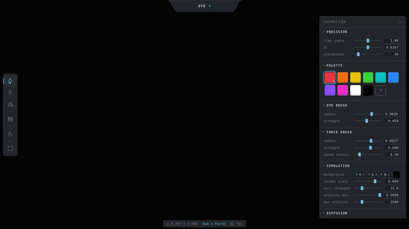

# Colorful.js

    

A real-time, texel-based fluid simulation that runs on the GPU in the browser. Paint dye into the flow, push it around, build walls, and tune every parameter of the solver while it runs.

## Features

### Brushes
- Dye: paint color into the fluid.
- Force: push the fluid with the mouse. Brush speed sets the strength of the push.
- Combined: dye and force at once.
- Wall: draw obstacles the fluid flows around. Hold Shift to erase.

### Views
Switch between dye, velocity, pressure, curl and divergence to see what the solver is doing. Non-dye views have adjustable palettes and scaling.

### Force field editor
Define a vector field in `GLSL` and watch it act on the fluid in real time. Edit the `get_velocity` function in the built-in editor, then press Ctrl+S to compile. Syntax errors are underlined on the offending line. Right-drag to pan across the field and use the mouse wheel or trackpad to zoom.

### Boundaries
Borders are solid by default. Toggle open borders to let the fluid flow out of the simulation freely.

### Full control
The inspector exposes the solver and the visuals:
- time step, time scale and pressure iterations
- vorticity confinement and velocity decay
- dye diffusion
- brush size and strength
- palette and visualizer scaling

Hover any label for an explanation and a guide to useful value ranges.

## Controls
| Input              | Action                                          |
|--------------------|-------------------------------------------------|
| Left mouse         | use the current brush                           |
| Right mouse + drag | Pan the force field                             |
| Wheel / trackpad   | Zoom the force field                            |
| `Q` `W` `E` `R`    | Dye + force, dye, force, wall brushes           |
| `1` - `5`          | Dye, velocity, pressure, curl, divergence views |
| `F`                | Toggle the force field                          |
| `TAB`              | Toggle open borders                             |
| `T`                | Open the force field editor                     |
| `Ctrl+S`           | Compile the force field (in the editor)         |
| `Backspace`        | Clear the simulation                            |

---

The [github pages deployment](https://phantom22.github.io/colorful.js/) works flawlessly on chromium-based browsers but, depending on your hardware and OS, can have some issues on firefox forks. If you are interested in playing around with the demo, cloning the project locally gives the best experience compatibility-wise.