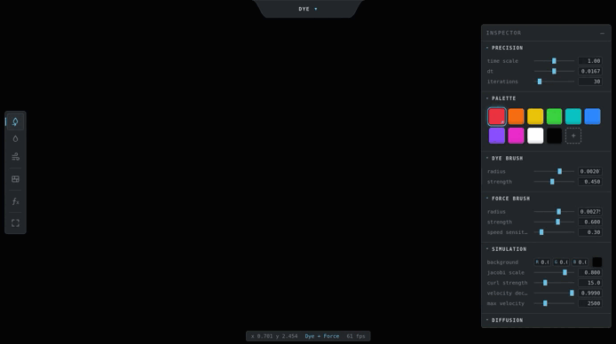

# Colorful.js

    

A real-time, texel-based fluid simulation that runs on the GPU in the browser. Paint dye into the flow, push it around, build walls, and tune every parameter of the solver while it runs.

## Features

### Brushes
- Dye: paint color into the fluid.
- Force: push the fluid with the mouse. Brush speed sets the strength of the push.
- Combined: dye and force at once.
- Wall: draw obstacles the fluid flows around. Pick the wall tool again to switch to the eraser (its button turns red), hold Shift to invert the current mode, hold Ctrl to draw a straight line.

### Views
Switch between dye, velocity, pressure, curl and divergence to see what the solver is doing. Non-dye views have adjustable palettes, scaling and auto exposure. An arrow overlay shows where the fluid moves (in the pressure view: where the pressure pushes it).

### Force field editor
Define a vector field in `GLSL` and watch it act on the fluid in real time. Edit the `get_velocity` function in the built-in editor, then press Ctrl+S to compile. Syntax errors are underlined on the offending line. Right-drag to pan across the field and use the mouse wheel or trackpad to zoom.

### Boundaries
Borders are solid by default. Toggle open borders to let the fluid flow out of the simulation freely.

### Full control
The inspector exposes the solver and the visuals:
- time step, time scale, sim and dye resolution
- pressure solve: multigrid V-cycles, smoothing sweeps and reach (how far the fluid pushes back on a stroke)
- vorticity confinement, velocity decay and drag
- dye diffusion
- brush sizes (in sim texels) and strengths
- palette, visualizer scaling, auto exposure and the arrow grid

Hover any label (tap it on touch devices) for an explanation and a guide to useful value ranges. Double-click a field to reset it; each section and the inspector header have reset buttons (the resolutions survive a full reset).

## Controls
Every key and gesture is listed in the app: press `?` or use the `?` button at the bottom of the toolbar (on touch devices it shows the touch gestures).

---

The [github pages deployment](https://phantom22.github.io/colorful.js/) works flawlessly on chromium-based browsers but, depending on your hardware and OS, can have some issues on firefox forks. If you are interested in playing around with the demo, cloning the project locally gives the best experience compatibility-wise.